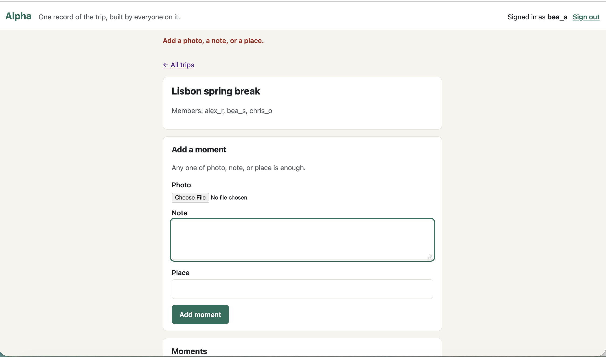

# Alpha: A Group Trip Record

## What

A shared trip record for groups who travel together: everyone on the trip adds photos, notes, and places as they happen, so the group can find what happened, where, and who added it long after the trip ends, without searching for details or photos.

## Team

| Member | Phase 1 | Phase 2 | Final |
|---|---|---|---|
| Semaj Johnson II | Reviewer | Specifier | Architect |
| Aashi Mehta | Implementer | Architect | Specifier |
| Rishika Sikhakolli | Specifier | Reviewer | Implementer |
| Giancarlo | Architect | Implementer | Reviewer |

Working agreement, RACI matrix, and rotation plan: [TEAM.md](TEAM.md).

## See It Work

**Live app:** https://alpha-trips.travlr.workers.dev

**Try it with a demo account** (synthetic data only): sign in as `bea_s` with password `alpha-demo-pass`, then open [Lisbon spring break](https://alpha-trips.travlr.workers.dev/#/trip/1) to see moments from three members in the order they were added.

**Run it locally:** `npm install`, then `npm run db:local`, then `npm run dev`, and open http://localhost:8787.

**Run the code evals** against the live app: `API=https://alpha-trips.travlr.workers.dev npm test` (or point `API` at http://localhost:8787 while `npm run dev` is running).

**Presentation:** [Phase 3 presentation slides (Canva)](https://canva.link/vo4vzatgvtw97pn)

## Status

Phase 1 decided four things: which problem to build (DACI-001), what to build (FEATURES.md), where it runs (ADR-001), and what would prove it works (EVALS.md). Phase 2 builds F1 (Accounts), F2 (Creating a trip and inviting members), F3 (Add a moment to a trip), and F4 (Trip view with who added what) first, because the riskiest assumption lives in these.

### Phase 2 Build Status

Deployed on Cloudflare Workers and D1, as ADR-001 decided. First deployed 2026-10-20 from Giancarlo's Cloudflare account; redeployed in Phase 3 from Rishika Sikhakolli's account, the Final Implementer's ([DEPLOY.md](docs/DEPLOY.md), [DDR-008](docs/DDR-008.md)).

| Feature | EARS rows | Manual check ([DDR-003](docs/DDR-003.md)) | Code eval ([evals/worker.test.js](evals/worker.test.js)) |
|---|---|---|---|
| F1 Accounts | F1-1, F1-2 | Pass | F1-2: Pass |
| F2 Create a trip and invite members | F2-1, F2-2, F2-3 | Pass | F2-2: Pass |
| F3 Add a moment to a trip | F3-1, F3-2, F3-3 | Pass | F3-3: Pass |
| F4 Trip view with who added what | F4-1, F4-2 | Pass | F4-2: Pass |

All four code evals passed against the deployed Worker on 2026-10-21 (EVALS.md lists one code eval per Must-be row with a server-side effect; the other rows are covered by the judgment eval and the manual checks). User validation sessions are in [VALIDATION.md](docs/VALIDATION.md).

Performance and Attractive features (F5 to F8) are not built yet.

### Phase 3 Status

Phase 3 integrated the build, redeployed it from the Final Implementer's account, and closed the learn loop in [RETRO.md](docs/RETRO.md). What is incomplete: features F5 to F8 are not built; no real group has used the deployed build, so the riskiest assumption is confirmed for photos, refuted for notes, and untested for the product itself; and the planned evals all passed without changing anything we did, which RETRO.md treats as a finding about the evals.

## Links, in Reading Order

1. [TEAM.md](TEAM.md): who owns what
2. [docs/DACI-001.md](docs/DACI-001.md): why this problem
3. [context/PROJECT.md](context/PROJECT.md): the problem, reframed
4. [context/USERS.md](context/USERS.md): users and their jobs
5. [context/FEATURES.md](context/FEATURES.md): Kano and EARS
6. [docs/PROBE-001.md](docs/PROBE-001.md): what bolt.new had to guess
7. [context/ARCHITECTURE.md](context/ARCHITECTURE.md): the Gate, ADR-001, the diagram
8. [context/EVALS.md](context/EVALS.md): the tree, the RAT, every member's stake
9. [context/CLAUDE.md](context/CLAUDE.md), [context/STANDARDS.md](context/STANDARDS.md), [context/TOOLS.md](context/TOOLS.md): how we work
10. [docs/DDR-001.md](docs/DDR-001.md): the probe delegation
11. [docs/DDR-002.md](docs/DDR-002.md): Copilot drafting the merged STANDARDS.md
12. [docs/DDR-003.md](docs/DDR-003.md): Claude drafting the Phase 2 Worker, D1 schema, seed data, and pages
13. [docs/DDR-004.md](docs/DDR-004.md): Claude drafting the Phase 2 evals, eval results, and reviews
14. [docs/VALIDATION.md](docs/VALIDATION.md) and [docs/DDR-005.md](docs/DDR-005.md): real-user sessions, and Claude drafting that record
15. Code: [src/worker.js](src/worker.js) (API), [public/](public/) (pages), [db/schema.sql](db/schema.sql) and [db/seed.sql](db/seed.sql) (D1), [wrangler.toml](wrangler.toml) (deployment)
16. Verification: [evals/worker.test.js](evals/worker.test.js) (code evals) and [docs/JUDGEMENT.md](docs/JUDGEMENT.md) (judgment eval, 10 of 10 passed with two graders)
17. Team style and skills, merged from all four members' HW5 versions: [STYLE.md](context/STYLE.md), [SKILLS.md](context/SKILLS.md)
18. [docs/DDR-006.md](docs/DDR-006.md), [docs/DDR-007.md](docs/DDR-007.md), [docs/DDR-008.md](docs/DDR-008.md), [docs/DDR-009.md](docs/DDR-009.md): the Phase 3 delegations
19. [docs/DDR-LOG.md](docs/DDR-LOG.md): every delegation with its hours
20. [docs/DEPLOY.md](docs/DEPLOY.md): deploying the Worker and D1 from a clean checkout
21. [docs/RETRO.md](docs/RETRO.md): the learn-loop retrospective
22. Individual retrospectives: [Semaj](docs/retro/semaj.md), [Rishika](docs/retro/rishika.md), [Giancarlo](docs/retro/giancarlo.md), [Aashi](docs/retro/aashi.md)
23. [CONTRIBUTIONS.md](CONTRIBUTIONS.md): what each member shipped, delegated, and reviewed

## AI Use

In Phase 1, AI tools were Responsible for one task (the bolt.new specification probe, DDR-001) and Consulted on 7 (drafting and critiquing of PROJECT.md, FEATURES.md, ARCHITECTURE.md, README.md, STANDARDS.md, TOOLS.md, and CLAUDE.md). No AI output was committed without a named reviewer. Nothing bolt.new generated is in this repository.

In Phase 2, Claude was Responsible for drafting the Worker, D1 schema, seed data, and pages ([DDR-003](docs/DDR-003.md)); Giancarlo is Accountable and verified every Must-be EARS row before committing. Claude also drafted the evals, eval results, and reviews ([DDR-004](docs/DDR-004.md), Rishika Accountable) and VALIDATION.md ([DDR-005](docs/DDR-005.md), Semaj Accountable). Copilot's drafting of STANDARDS.md is recorded in [DDR-002](docs/DDR-002.md).

In Phase 3, Claude helped draft the ARCHITECTURE.md additions, DEPLOY.md, and Semaj's retrospective ([DDR-006](docs/DDR-006.md), Semaj Accountable); the context review, EVALS.md close-out, RETRO.md sections, and DDR-LOG.md ([DDR-007](docs/DDR-007.md), Giancarlo Accountable); and the redeploy, README edits, Phase 3 RACI rows, Rishika's retrospective, and the recording script ([DDR-008](docs/DDR-008.md), Rishika Accountable). Every delegation, with net hours, is in [DDR-LOG.md](docs/DDR-LOG.md).
