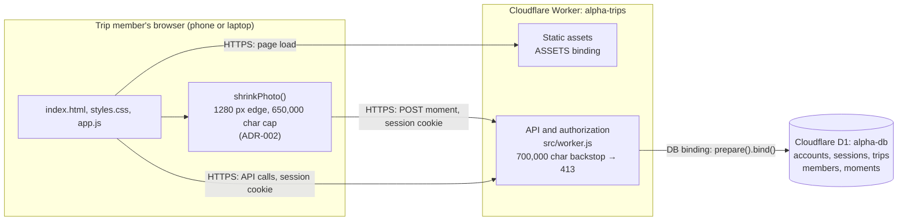

# ARCHITECTURE.md

Accountable: Semaj Johnson II, Phase 3 Architect (previously Aashi Mehta, Phase 2; Giancarlo, Phase 1). Weights were committed in their own commit before any option was scored; the commit history is the evidence.

This is the final state of the architecture. The Gate and ADR-001 below are Phase 1 records and are not edited. ADR-002, the ADR history, and the sections after the diagram are the Phase 3 additions: what the build actually did, what the measurements said about it, and what is still open.

## The Gate: Build, Buy, or Delegate

This gate applies to the first product slice described by the team: a casual,
photo-first travel diary for places a person has visited, with category
filtering. Ranking visited places by city and category is a future direction,
not a committed feature in this decision.

### Weights (committed before scores)

| Criterion | Weight (1 to 5) | Why this weight |
|---|---:|---|
| Supports the group-trip flow (F1 to F4: accounts, invites, moments, who added what) | 5 | These are the Must-be features in FEATURES.md. An option that cannot do shared trips fails the product. |
| Fits the course stack and STANDARDS.md | 4 | The team has built on static pages, Workers, and D1 in HW4 and HW5. An option outside that stack costs learning time we do not have. |
| Limits exposure of trip photos and notes | 5 | Photos and visit history reveal where people were and when. Fewer parties holding them means fewer crossings to account for. |
| Buildable and testable by the team in Phase 2 | 4 | Phase 2 is three weeks. We must be able to run, inspect, and fix the result ourselves. |
| Switching cost, scored from HW4 and HW5 experience | 3 | In HW4 and HW5, leaving our own Worker and D1 took one `wrangler d1 export` and a rewrite of one Worker. Leaving a hosted product means losing data or re-entering it, so this decides how reversible the choice is. |

### Scores (1 to 5)

| Criterion | Weight | Build: static page, Cloudflare Worker, D1 | Buy: off-the-shelf shared trip album (for example, Google Photos shared albums) | Delegate: bolt.new-generated and hosted app |
|---|---:|---:|---:|---:|
| Supports the group-trip flow (F1 to F4) | 5 | 5 | 3 | 4 |
| Fits the course stack and STANDARDS.md | 4 | 5 | 1 | 2 |
| Limits exposure of trip photos and notes | 5 | 4 | 2 | 2 |
| Buildable and testable by the team in Phase 2 | 4 | 4 | 2 | 3 |
| Switching cost, scored from HW4 and HW5 experience | 3 | 4 | 1 | 2 |
| **Weighted total (max 105)** | | **93** | **40** | **56** |

**Score rationale**

- **Build:** We control every screen and every row F1 to F4 needs, on the stack we used in HW4 and HW5. Exposure is a 4, not a 5, because data still crosses to Cloudflare. Buildability is a 4 because accounts and photo storage are new to us.
- **Buy:** A shared album handles photos and shows who added them, but not notes, places, search (F5), or our invite rules. It sits outside our stack, sends photos to another large vendor, and leaves nothing for us to build or test. Leaving it later means exporting albums by hand, so switching cost scores 1.
- **Delegate:** The bolt.new probe showed it can produce a plausible app quickly, but it guessed six things our spec did not say (PROBE-001). We would own code we did not write, hosted outside our stack, and moving off its hosting means rewriting the backend.

## ADR-001: Build the Travel App on Cloudflare Workers and D1

### Status

Accepted, 2026-10-08. Driver: Giancarlo (Phase 1 Architect). Approver: Rishika Sikhakoli (Phase 1 Specifier).

### Context

The team is building a group trip record (PROJECT.md): members sign up (F1), create a trip and invite others by link (F2), add moments with a photo, note, or place (F3), and see who added what (F4). Accounts and shared trips need a server; a browser-only app cannot share a trip between people.

The riskiest assumption in EVALS.md is that people add moments *during* a trip, not after. That makes capture speed on a phone the constraint that matters most, which favors a small static page and a single write endpoint over a large framework or hosted product.

**The crossing.** Account details (email, username, and a password hash, never the password itself), trip names, invite links, moments (photos, notes, places), member names on each moment, and request metadata including IP addresses leave the browser and go to Cloudflare (Workers for the API, D1 for storage), under Cloudflare's free-plan terms, in a region we do not choose. Aashi Mehta, who holds the Cloudflare account, is accountable for this crossing (TOOLS.md).

### Options

1. **Build:** static page, Cloudflare Worker, and D1, written by the team. Gate total 93.
2. **Buy:** an off-the-shelf shared trip album. Gate total 40.
3. **Delegate:** a bolt.new-generated and hosted app. Gate total 56.

### Decision

Build option 1. Structure lives in `index.html`, presentation in `styles.css`, and behavior in `app.js`; one Worker serves the API, and D1 stores accounts, trips, members, and moments. All SQL goes through `prepare().bind()` (STANDARDS.md). No other external service is added without a new ADR and a TOOLS.md row.

### Consequences

- Trip data stays with one vendor (Cloudflare), and the team controls every screen F1 to F4 needs.
- Leaving later is one `wrangler d1 export` and a rewrite of one Worker, as in HW4 and HW5.
- **Harder:** we now own account security. Storing password hashes, checking invite links, and blocking non-members from private trips (F2-2) are our bugs to prevent.
- **Harder:** D1 is built for rows of text, not large photos. Full-size phone photos may need resizing in the browser or a separate file store, which would require revising this ADR (see Giancarlo's Prediction Stake in EVALS.md).
- Data sits in a Cloudflare region we do not choose, under terms we do not negotiate.

### Revisit Trigger

Revisit by 2026-10-29 if photo uploads fail the test in Giancarlo's Prediction Stake, or if the RAT fails in user interviews by 2026-10-22.

### Revisit Trigger: Resolved 2026-10-27

Both conditions came due and neither forces a rewrite, but one of them forces a decision that had never been written down.

**Photo uploads.** Giancarlo's Prediction Stake resolved **Correct** on 2026-10-21: three of three full-size phone photos saved and displayed on Workers and D1 with no added storage service — but only because the build shrinks every photo in the browser first. The prediction's own terms ("if all three save and display through Workers and D1 alone, with no added service **or resizing step**, this prediction is wrong") make the resizing step the thing that saved it. ADR-001 named Workers and D1 and left resizing as an unmade choice. The build made it. ADR-002 records it.

**The RAT.** The RAT resolved **Mixed** on 2026-10-20, not failed: 3 of 3 people took photos during the trip, 2 of 3 posted during, but only 1 of 3 wrote notes during. Photos are captured in the moment; text mostly is not. That does not threaten ADR-001 — a single Worker and one write endpoint is still the right shape for fast capture. It does change what the schema will be asked to do next, which is recorded under "What the Measurements Changed" below.

## ADR-002: Shrink Photos in the Browser Instead of Adding a File Store

### Status

Accepted, 2026-10-27. **Refines ADR-001; does not supersede it.** ADR-001 remains Accepted and the stack it names is unchanged. Driver: Semaj Johnson II (Phase 3 Architect). Approver: Rishika Sikhakolli (Phase 3 Implementer), who owns the integrated build and inherits the consequence. Consulted: Giancarlo Martinez-Saldana (Phase 2 Implementer), who built the mechanism this ADR records.

### Context

ADR-001 chose Workers and D1 and added nothing else. Under Consequences it flagged the gap honestly and left it open: "D1 is built for rows of text, not large photos. Full-size phone photos may need resizing in the browser or a separate file store, which would require revising this ADR." It tied the outcome to Giancarlo's Prediction Stake rather than guessing.

The stake resolved Correct. The Phase 2 build shrinks photos in the browser, and `docs/DDR-003.md` handed the decision forward in writing: "Photos are resized in the browser and stored in D1 as data URLs, capped by the Worker. This follows ADR-001's consequences; if real phone photos fail, that is an ADR-002 decision for the Architect."

So the mechanism is deployed, it has been measured, and until now no decision record named it. A mechanism in the code that no ADR owns is the thing ADRs exist to prevent.

### Options

1. **Shrink in the browser and store the result in D1.** What the build does. No new service.
2. **Add a file store (Cloudflare R2) and keep photos at full size.** Keeps originals; adds a vendor, a binding, a TOOLS.md row, and a second crossing.
3. **Refuse photos over D1's limit and ask the member to shrink them.** No new service and no quality loss, but it puts work on the member at exactly the moment F3 exists to make fast.

### Decision

Option 1, with two ceilings, the client's deliberately stricter than the server's.

**In the browser** (`public/app.js`): `MAX_PHOTO_EDGE = 1280` pixels on the longest edge and `MAX_PHOTO_CHARS = 650000`. `shrinkPhoto()` re-encodes to JPEG at quality 0.75; if the data URL is still over the ceiling it retries up to six times, each pass scaling the longest edge to 75 percent and dropping quality by 0.05 to a floor of 0.5. If all six fail it throws, and the member sees "That photo could not be used. Try a JPEG or PNG."

**In the Worker** (`src/worker.js`): `MAX_PHOTO_CHARS = 700000`, plus a data-URL prefix check that accepts only `image/jpeg`, `image/png`, or `image/webp` base64. Over the ceiling returns 413, "That photo is too large even after resizing."

The 50,000-character gap between 650,000 and 700,000 is the point, not an inconsistency. A photo that clears the browser can never trip the Worker's 413, so the server ceiling is a backstop against a client that has been bypassed rather than a limit members actually meet. Cloudflare documents D1's maximum single value at 2,000,000 bytes, so 700,000 characters of base64 leaves room for the note, the place, and the rest of the row.

Option 3 was rejected on the RAT: photos are the one thing people reliably capture in the moment, so the photo path is the worst place in the app to add a manual step. Option 2 was rejected because option 1 works at the sizes measured, and a second vendor is a crossing to account for and a switching cost to carry for a problem we do not have yet.

### Consequences

- No storage service is added, so the diagram, `wrangler.toml`, and TOOLS.md are unchanged, and leaving Cloudflare is still one `wrangler d1 export` and one Worker rewrite.
- **Photos are permanently degraded on upload and the original is never stored.** The app is not a backup of anyone's camera roll, and nothing in the product says so. A member who wants the full-resolution photo keeps it themselves.
- 1280 pixels looks right on a phone and visibly soft on a laptop at full width. **Nobody measured whether members mind.** The validation sessions did not ask, so this is an untested consequence of a tested decision.
- **Two ceilings in two files have to be kept in step.** If a later change raises the browser's 650,000 above the Worker's 700,000, members will start meeting 413s the browser promised would not happen. Both constants are named above so the pair is findable from this document.
- **F7 (video moments) does not fit this design at all.** Video would need the file store this ADR declined, and would supersede it rather than refine it.

### Revisit Trigger

Revisit if any one of: F7 is scheduled; a member reports 1280 pixels as too soft; or notes and places grow large enough that a 700,000-character photo plus text approaches D1's 2,000,000-byte row limit.

## ADR History

| ADR | Decision | Status | Driver | What changed it |
|---|---|---|---|---|
| ADR-001 | Build the travel app on Cloudflare Workers and D1 | **Accepted** 2026-10-08. Still in force; not superseded. | Giancarlo (Phase 1 Architect) | The Gate: Build scored 93 of 105 against Buy 40 and Delegate 56. |
| ADR-002 | Shrink photos in the browser instead of adding a file store | **Accepted** 2026-10-27. Refines ADR-001. | Semaj Johnson II (Phase 3 Architect) | Giancarlo's Prediction Stake resolved Correct on 2026-10-21, but only because of a resizing step ADR-001 had left as an open choice. DDR-003 named it as the Architect's decision. |

Nothing has been superseded. The stack in ADR-001 is the stack that is deployed, and the coherence check below is the evidence.

## D1 Schema

The schema supports the four Must-be features in FEATURES.md (F1 to F4). `db/schema.sql` creates it and `db/seed.sql` seeds it with synthetic data. The SQL below is a copy of `db/schema.sql`; if the two ever differ, `db/schema.sql` is what is deployed and this section is out of date.

### Tables and Relationships

- `accounts`: one row per registered person. Email and username are each unique regardless of capitalization (`COLLATE NOCASE`), as F1-2 requires. Only a password hash is stored.
- `sessions`: one row per signed-in browser, so F1-1 can sign a person in right after sign-up. Only a hash of the session token is stored; the token itself stays in the browser cookie.
- `trips`: one row per trip, with its creator and one reusable invitation token, stored only as a hash (F2-1, F2-3).
- `members`: join table between accounts and trips. The composite primary key `(trip_id, account_id)` prevents joining the same trip twice.
- `moments`: a photo, note, or place added to a trip. A composite foreign key `(trip_id, author_id)` to `members` means only a member of a trip can have a moment in it. A CHECK constraint requires at least one of photo, note, or place to be non-blank after trimming (F3-3). The index `moments_by_trip` serves the added-order listing in F4-1.

```sql
-- D1 enforces foreign keys by default.

DROP TABLE IF EXISTS moments;
DROP TABLE IF EXISTS members;
DROP TABLE IF EXISTS trips;
DROP TABLE IF EXISTS sessions;
DROP TABLE IF EXISTS accounts;

-- F1: usernames and emails are unique regardless of capitalization (F1-2).
CREATE TABLE accounts (
  id            INTEGER PRIMARY KEY,
  email         TEXT NOT NULL UNIQUE COLLATE NOCASE,
  username      TEXT NOT NULL UNIQUE COLLATE NOCASE,
  password_hash TEXT NOT NULL,
  created_at    TEXT NOT NULL DEFAULT (datetime('now'))
);

-- F1-1 signs a person in after sign-up, so logins need somewhere to live.
-- Only a hash of the session token is stored; the token itself stays in the browser cookie.
CREATE TABLE sessions (
  token_hash TEXT PRIMARY KEY,
  account_id INTEGER NOT NULL REFERENCES accounts(id) ON DELETE CASCADE,
  expires_at TEXT NOT NULL
);

-- F2-1 and F2-3: one reusable invite link per trip, stored only as a hash.
CREATE TABLE trips (
  id                INTEGER PRIMARY KEY,
  name              TEXT NOT NULL CHECK (length(trim(name)) > 0),
  creator_id        INTEGER NOT NULL REFERENCES accounts(id),
  invite_token_hash TEXT NOT NULL UNIQUE,
  created_at        TEXT NOT NULL DEFAULT (datetime('now'))
);

-- The composite key prevents joining the same trip twice.
CREATE TABLE members (
  trip_id    INTEGER NOT NULL REFERENCES trips(id) ON DELETE CASCADE,
  account_id INTEGER NOT NULL REFERENCES accounts(id) ON DELETE CASCADE,
  joined_at  TEXT NOT NULL DEFAULT (datetime('now')),
  PRIMARY KEY (trip_id, account_id)
);

-- F3: only a member can add to a trip, and a moment needs at least one of photo, note, or place (F3-3).
CREATE TABLE moments (
  id             INTEGER PRIMARY KEY,
  trip_id        INTEGER NOT NULL,
  author_id      INTEGER NOT NULL,
  photo_data_url TEXT,
  note           TEXT,
  place          TEXT,
  created_at     TEXT NOT NULL DEFAULT (datetime('now')),
  FOREIGN KEY (trip_id, author_id) REFERENCES members(trip_id, account_id) ON DELETE CASCADE,
  CHECK (
    length(trim(coalesce(photo_data_url, ''))) > 0
    OR length(trim(coalesce(note, ''))) > 0
    OR length(trim(coalesce(place, ''))) > 0
  )
);

-- F4-1 lists a trip's moments in added order.
CREATE INDEX moments_by_trip ON moments (trip_id, created_at, id);
```

### Integrity and Authorization

Enforced by the database:

- Email and username uniqueness, case-insensitive (F1-2).
- A moment can only be written by an existing member of its trip.
- A moment cannot be entirely blank (F3-3), and a trip name cannot be blank.

Enforced by the Worker, because the database cannot know who is asking:

- The trip creator is inserted into `members` when the trip is created.
- An invitation token is hashed and matched against `trips.invite_token_hash` before a person is added to `members`.
- Membership is checked before private trip data is returned (F2-2).
- Deleting a moment is refused unless the requester is its author (F4-2).
- All application SQL uses `prepare().bind()`, as STANDARDS.md requires.

### Consequences of This Schema

- **Removing a member deletes their moments.** `moments` cascades from `members`, so a future "leave trip" feature would erase that person's contributions unless it is designed otherwise.
- **`db/schema.sql` begins with `DROP TABLE` statements.** Running `npm run db:remote` against the deployed database erases every row, including test and tester data. Run it for setup, not after data exists that must be kept.
- **Trips have no start or end date.** Only each moment's own `created_at` is recorded, so the RAT's build signal ("moments added after the trip ended") cannot be read from this schema.
- **The invitation token is stored only as a hash**, so a lost invite link cannot be displayed again; a new one would have to be issued.

### Photo Storage

`moments.photo_data_url` holds the photo as a data URL inside D1, as ADR-001 decided. `wrangler.toml` binds only `DB` (D1) and `ASSETS` (static pages); there is no file-storage service.

Cloudflare documents the maximum size of a single string, BLOB, or table row in D1 as 2,000,000 bytes (https://developers.cloudflare.com/d1/platform/limits/). A data URL is base64, about one third larger than the image, so a photo must be roughly 1.5 MB or less before encoding to fit its row together with a note and place. Full-size phone photos are usually larger, so the design requires the photo to be reduced in the browser before upload.

Giancarlo's Prediction Stake tested exactly that and resolved Correct on 2026-10-21. **ADR-002 now records the reduction as a decision**, with both ceilings and their values. Read ADR-002 before changing either constant.

Moving photos to a separate file-storage service would still depart from ADR-001 and would supersede ADR-002 rather than refine it. No such departure has been made.

## Architecture Diagram



The boxes match the deployed system one for one: a single Worker serves both the static pages and the API, and talks to a single D1 database. **There is no file-storage service, no model proxy, and no AI Gateway** — `src/worker.js` makes no outbound request, and its only bindings are `env.DB` and `env.ASSETS`. If any of those is added, this diagram changes in the same pull request as the ADR that adds it.

The photo shrink is drawn inside the browser rather than left implicit because ADR-002 makes it load-bearing: it is the only reason photos fit in D1 at all, and the only step in the system that destroys data the member cannot get back.

## What the Measurements Changed

The Phase 3 question for this document is not whether the architecture is defensible but whether anything measured in Phase 2 moved it. One thing did. Most did not, and a check that changes nothing is still a finding about the check.

| Measurement | Result | What it changed here |
|---|---|---|
| Giancarlo's Prediction Stake: full-size phone photos will not work in D1 | **Correct** (2026-10-21) — three of three saved, but only because the build shrinks them first | **ADR-002.** The one real architectural change in Phase 2. No new service, but the resizing step went from an unmade choice in ADR-001's consequences to a named decision with both ceilings recorded. |
| RAT: people add moments *during* a trip, not after | **Mixed** (2026-10-20) — 3 of 3 took photos during, 1 of 3 wrote notes during | Nothing in the stack, which is the right outcome: one Worker and one write endpoint is still the shape fast capture wants. It moves what F5 will need. See below. |
| Semaj's stake: fewer than half of moments will carry all three fields | **Correct** — 3 of 7 carried photo, note, and place | Confirmed the `moments` CHECK constraint, which accepts any one field, and confirmed F4-1 has to read well against mostly-partial rows. No change. |
| Rishika's stake: notes will be the field people skip | **Wrong** — 7 of 7 moments carried a note | No change, and the reason is the finding. `docs/VALIDATION.md` says the test trip was teammates filling in a form rather than members on a trip, so the schema was never exercised against the behavior the RAT actually found. |
| Four code evals: F1-2, F2-2, F3-3, F4-2 | **All pass** against the deployed Worker (2026-10-21) | Confirmed the authorization split this document describes — the database enforces uniqueness and non-blank moments, the Worker enforces membership and authorship. No change. |
| Judgment eval, 10 of 10 with two graders | **Pass** | No change. It checked what members see, not where anything runs, so architecture was never in its scope. |

### A measurement the schema made impossible

The RAT named two signals: the interviews, and "moments whose timestamps cluster after a trip's end date rather than during it." That second signal could not be read at all. `trips` stores a name, a creator, an invite hash, and `created_at` — it has no trip start or end date, so the deployed database cannot say whether a moment landed during a trip or three weeks later. The RAT had to be settled on interviews alone.

This is a schema decision quietly constraining a measurement, and it is worth naming because nobody chose it on purpose. If the team had wanted the build to help answer its own riskiest assumption, `trips` needed two date columns in Phase 1. The schema's consequences section flagged the gap; this is what the gap cost.

### What the RAT points at, and the schema cannot do yet

The RAT found that people look for an old moment by a word they remember, by asking someone, or not at all — and that notes are mostly written after the trip rather than during it. F5 (Find it later) is where that lands, and the schema is not ready for it. The only index on `moments` is `moments_by_trip (trip_id, created_at, id)`, which serves F4-1's added-order listing and a date range. It does nothing for a search by place, by member, or by a word in a note.

Building F5 on that finding needs either an index on `place` and `author_id` or D1's full-text search, and that would be **ADR-003**. F5 is not built, so no ADR-003 has been written. Naming the gap is the deliverable here; filling it is not Phase 3 work.

## What Is Still Open

1. **The deployment account.** The deployment moved on 2026-10-26, and three files have not caught up. The build now runs from the Final-phase Implementer’s Cloudflare account as Phase 3 asks — alpha-trips.travlr.workers.dev, Rishika’s, replacing Giancarlo’s — and README.md (#100) points there. But wrangler.toml still carries the Phase 2 database_id, context/TOOLS.md still names Giancarlo’s account and laptop in the Cloudflare and wrangler rows with no dated handoff row, and the header comment in evals/worker.test.js still shows the old URL in its API= example. The database_id is the one that breaks something: a clean checkout deploys against the wrong database. docs/DEPLOY.md has the procedure and the checklist for this exact move.
2. **F5 through F8 are not built**, so this architecture has only ever been exercised by the four Must-be features.
3. **1280 pixels is untested with members.** ADR-002 degrades every photo and no session asked anyone whether they noticed.
4. **The behavior the architecture was tested against is not the behavior the RAT found.** Four teammate accounts in one trip, in one sitting, is the sample behind every stake resolution above.

## Coherence Check: The ADRs Against the Deployed Build

Re-verified 2026-10-27 against the files on `main`.

| Claim | Evidence | Status |
|---|---|---|
| ADR-001: runs on Cloudflare Workers and D1 | `wrangler.toml`: Worker `alpha-trips`, D1 binding `DB` to `alpha-db` | Matches |
| ADR-001: static pages `index.html`, `styles.css`, `app.js` | `[assets]` binding to `./public`; `index.html` loads `styles.css` and `app.js` | Matches |
| ADR-001: photos in D1, no separate file storage | `wrangler.toml` binds only `DB` and `ASSETS`; `moments.photo_data_url` holds the data URL | Matches |
| ADR-001: all application SQL through `prepare().bind()` | `src/worker.js`; the only `env.*` references in the Worker are `env.DB` and `env.ASSETS` | Matches |
| ADR-001: no external service beyond Cloudflare | `src/worker.js` makes no outbound request; no model proxy, no AI Gateway | Matches |
| ADR-002: browser ceilings 1280 px and 650,000 characters | `public/app.js`: `MAX_PHOTO_EDGE = 1280`, `MAX_PHOTO_CHARS = 650000`, `shrinkPhoto()` | Matches |
| ADR-002: Worker ceiling 700,000 characters, stricter client | `src/worker.js`: `MAX_PHOTO_CHARS = 700000`, 413 above it, prefix check on the data URL | Matches |
| This document describes the deployed schema | SQL block above is a copy of `db/schema.sql` | Matches |
| This diagram describes the deployed system | One Worker serving pages and API, one D1 database, nothing else | Matches |

**Departures: none.** ADR-001 is Accepted and not superseded; ADR-002 refines it. Every row above was checked against the file named beside it rather than against this document's own earlier claims.
