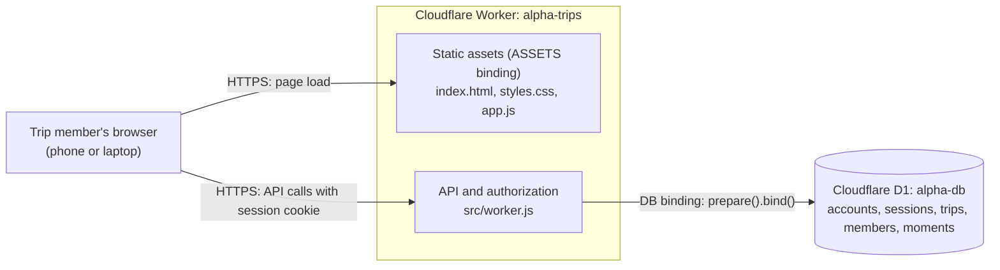

# ARCHITECTURE.md

Accountable: Aashi Mehta, Phase 2 Architect. Weights were committed in their own commit before any option was scored; the commit history is the evidence.

## The Gate: Build, Buy, or Delegate

This gate applies to the first product slice described by the team: a casual,
photo-first travel diary for places a person has visited, with category
filtering. Ranking visited places by city and category is a future direction,
not a committed feature in this decision.

### Weights (committed before scores)

| Criterion | Weight (1 to 5) | Why this weight |
|---|---:|---|
| Supports the group-trip flow (F1 to F4: accounts, invites, moments, who added what) | 5 | These are the Must-be features in FEATURES.md. An option that cannot do shared trips fails the product. |
| Fits the course stack and STANDARDS.md | 4 | The team has built on static pages, Workers, and D1 in HW4 and HW5. An option outside that stack costs learning time we do not have. |
| Limits exposure of trip photos and notes | 5 | Photos and visit history reveal where people were and when. Fewer parties holding them means fewer crossings to account for. |
| Buildable and testable by the team in Phase 2 | 4 | Phase 2 is three weeks. We must be able to run, inspect, and fix the result ourselves. |
| Switching cost, scored from HW4 and HW5 experience | 3 | In HW4 and HW5, leaving our own Worker and D1 took one `wrangler d1 export` and a rewrite of one Worker. Leaving a hosted product means losing data or re-entering it, so this decides how reversible the choice is. |

### Scores (1 to 5)

| Criterion | Weight | Build: static page, Cloudflare Worker, D1 | Buy: off-the-shelf shared trip album (for example, Google Photos shared albums) | Delegate: bolt.new-generated and hosted app |
|---|---:|---:|---:|---:|
| Supports the group-trip flow (F1 to F4) | 5 | 5 | 3 | 4 |
| Fits the course stack and STANDARDS.md | 4 | 5 | 1 | 2 |
| Limits exposure of trip photos and notes | 5 | 4 | 2 | 2 |
| Buildable and testable by the team in Phase 2 | 4 | 4 | 2 | 3 |
| Switching cost, scored from HW4 and HW5 experience | 3 | 4 | 1 | 2 |
| **Weighted total (max 105)** | | **93** | **40** | **56** |

**Score rationale**

- **Build:** We control every screen and every row F1 to F4 needs, on the stack we used in HW4 and HW5. Exposure is a 4, not a 5, because data still crosses to Cloudflare. Buildability is a 4 because accounts and photo storage are new to us.
- **Buy:** A shared album handles photos and shows who added them, but not notes, places, search (F5), or our invite rules. It sits outside our stack, sends photos to another large vendor, and leaves nothing for us to build or test. Leaving it later means exporting albums by hand, so switching cost scores 1.
- **Delegate:** The bolt.new probe showed it can produce a plausible app quickly, but it guessed six things our spec did not say (PROBE-001). We would own code we did not write, hosted outside our stack, and moving off its hosting means rewriting the backend.

## ADR-001: Build the Travel App on Cloudflare Workers and D1

### Status

Accepted, 2026-10-08. Driver: Giancarlo (Phase 1 Architect). Approver: Rishika Sikhakoli (Phase 1 Specifier).

### Context

The team is building a group trip record (PROJECT.md): members sign up (F1), create a trip and invite others by link (F2), add moments with a photo, note, or place (F3), and see who added what (F4). Accounts and shared trips need a server; a browser-only app cannot share a trip between people.

The riskiest assumption in EVALS.md is that people add moments *during* a trip, not after. That makes capture speed on a phone the constraint that matters most, which favors a small static page and a single write endpoint over a large framework or hosted product.

**The crossing.** Account details (email, username, and a password hash, never the password itself), trip names, invite links, moments (photos, notes, places), member names on each moment, and request metadata including IP addresses leave the browser and go to Cloudflare (Workers for the API, D1 for storage), under Cloudflare's free-plan terms, in a region we do not choose. Aashi Mehta, who holds the Cloudflare account, is accountable for this crossing (TOOLS.md).

### Options

1. **Build:** static page, Cloudflare Worker, and D1, written by the team. Gate total 93.
2. **Buy:** an off-the-shelf shared trip album. Gate total 40.
3. **Delegate:** a bolt.new-generated and hosted app. Gate total 56.

### Decision

Build option 1. Structure lives in `index.html`, presentation in `styles.css`, and behavior in `app.js`; one Worker serves the API, and D1 stores accounts, trips, members, and moments. All SQL goes through `prepare().bind()` (STANDARDS.md). No other external service is added without a new ADR and a TOOLS.md row.

### Consequences

- Trip data stays with one vendor (Cloudflare), and the team controls every screen F1 to F4 needs.
- Leaving later is one `wrangler d1 export` and a rewrite of one Worker, as in HW4 and HW5.
- **Harder:** we now own account security. Storing password hashes, checking invite links, and blocking non-members from private trips (F2-2) are our bugs to prevent.
- **Harder:** D1 is built for rows of text, not large photos. Full-size phone photos may need resizing in the browser or a separate file store, which would require revising this ADR (see Giancarlo's Prediction Stake in EVALS.md).
- Data sits in a Cloudflare region we do not choose, under terms we do not negotiate.

### Revisit Trigger

Revisit by 2026-10-29 if photo uploads fail the test in Giancarlo's Prediction Stake, or if the RAT fails in user interviews by 2026-10-22.

## D1 Schema

The schema supports the four Must-be features in FEATURES.md (F1 to F4). `db/schema.sql` creates it and `db/seed.sql` seeds it with synthetic data. The SQL below is a copy of `db/schema.sql`; if the two ever differ, `db/schema.sql` is what is deployed and this section is out of date.

### Tables and Relationships

- `accounts`: one row per registered person. Email and username are each unique regardless of capitalization (`COLLATE NOCASE`), as F1-2 requires. Only a password hash is stored.
- `sessions`: one row per signed-in browser, so F1-1 can sign a person in right after sign-up. Only a hash of the session token is stored; the token itself stays in the browser cookie.
- `trips`: one row per trip, with its creator and one reusable invitation token, stored only as a hash (F2-1, F2-3).
- `members`: join table between accounts and trips. The composite primary key `(trip_id, account_id)` prevents joining the same trip twice.
- `moments`: a photo, note, or place added to a trip. A composite foreign key `(trip_id, author_id)` to `members` means only a member of a trip can have a moment in it. A CHECK constraint requires at least one of photo, note, or place to be non-blank after trimming (F3-3). The index `moments_by_trip` serves the added-order listing in F4-1.

```sql
-- D1 enforces foreign keys by default.

DROP TABLE IF EXISTS moments;
DROP TABLE IF EXISTS members;
DROP TABLE IF EXISTS trips;
DROP TABLE IF EXISTS sessions;
DROP TABLE IF EXISTS accounts;

-- F1: usernames and emails are unique regardless of capitalization (F1-2).
CREATE TABLE accounts (
  id            INTEGER PRIMARY KEY,
  email         TEXT NOT NULL UNIQUE COLLATE NOCASE,
  username      TEXT NOT NULL UNIQUE COLLATE NOCASE,
  password_hash TEXT NOT NULL,
  created_at    TEXT NOT NULL DEFAULT (datetime('now'))
);

-- F1-1 signs a person in after sign-up, so logins need somewhere to live.
-- Only a hash of the session token is stored; the token itself stays in the browser cookie.
CREATE TABLE sessions (
  token_hash TEXT PRIMARY KEY,
  account_id INTEGER NOT NULL REFERENCES accounts(id) ON DELETE CASCADE,
  expires_at TEXT NOT NULL
);

-- F2-1 and F2-3: one reusable invite link per trip, stored only as a hash.
CREATE TABLE trips (
  id                INTEGER PRIMARY KEY,
  name              TEXT NOT NULL CHECK (length(trim(name)) > 0),
  creator_id        INTEGER NOT NULL REFERENCES accounts(id),
  invite_token_hash TEXT NOT NULL UNIQUE,
  created_at        TEXT NOT NULL DEFAULT (datetime('now'))
);

-- The composite key prevents joining the same trip twice.
CREATE TABLE members (
  trip_id    INTEGER NOT NULL REFERENCES trips(id) ON DELETE CASCADE,
  account_id INTEGER NOT NULL REFERENCES accounts(id) ON DELETE CASCADE,
  joined_at  TEXT NOT NULL DEFAULT (datetime('now')),
  PRIMARY KEY (trip_id, account_id)
);

-- F3: only a member can add to a trip, and a moment needs at least one of photo, note, or place (F3-3).
CREATE TABLE moments (
  id             INTEGER PRIMARY KEY,
  trip_id        INTEGER NOT NULL,
  author_id      INTEGER NOT NULL,
  photo_data_url TEXT,
  note           TEXT,
  place          TEXT,
  created_at     TEXT NOT NULL DEFAULT (datetime('now')),
  FOREIGN KEY (trip_id, author_id) REFERENCES members(trip_id, account_id) ON DELETE CASCADE,
  CHECK (
    length(trim(coalesce(photo_data_url, ''))) > 0
    OR length(trim(coalesce(note, ''))) > 0
    OR length(trim(coalesce(place, ''))) > 0
  )
);

-- F4-1 lists a trip's moments in added order.
CREATE INDEX moments_by_trip ON moments (trip_id, created_at, id);
```

### Integrity and Authorization

Enforced by the database:

- Email and username uniqueness, case-insensitive (F1-2).
- A moment can only be written by an existing member of its trip.
- A moment cannot be entirely blank (F3-3), and a trip name cannot be blank.

Enforced by the Worker, because the database cannot know who is asking:

- The trip creator is inserted into `members` when the trip is created.
- An invitation token is hashed and matched against `trips.invite_token_hash` before a person is added to `members`.
- Membership is checked before private trip data is returned (F2-2).
- Deleting a moment is refused unless the requester is its author (F4-2).
- All application SQL uses `prepare().bind()`, as STANDARDS.md requires.

### Consequences of This Schema

- **Removing a member deletes their moments.** `moments` cascades from `members`, so a future "leave trip" feature would erase that person's contributions unless it is designed otherwise.
- **`db/schema.sql` begins with `DROP TABLE` statements.** Running `npm run db:remote` against the deployed database erases every row, including test and tester data. Run it for setup, not after data exists that must be kept.
- **Trips have no start or end date.** Only each moment's own `created_at` is recorded, so the RAT's build signal ("moments added after the trip ended") cannot be read from this schema.
- **The invitation token is stored only as a hash**, so a lost invite link cannot be displayed again; a new one would have to be issued.

### Photo Storage

`moments.photo_data_url` holds the photo as a data URL inside D1, as ADR-001 decided. `wrangler.toml` binds only `DB` (D1) and `ASSETS` (static pages); there is no file-storage service.

Cloudflare documents the maximum size of a single string, BLOB, or table row in D1 as 2,000,000 bytes (https://developers.cloudflare.com/d1/platform/limits/). A data URL is base64, about one third larger than the image, so a photo must be roughly 1.5 MB or less before encoding to fit its row together with a note and place. Full-size phone photos are usually larger, so the design requires the photo to be reduced in the browser before upload. Whether that holds for the deployed build is the claim tested by Giancarlo's Prediction Stake in EVALS.md.

Moving photos to a separate file-storage service would depart from ADR-001 and requires a superseding ADR (ADR-002), with ADR-001 marked Superseded, before it is built. No such departure has been made.

## Architecture Diagram



The boxes match the deployed system one for one: a single Worker serves both the static pages and the API, and talks to a single D1 database. There is no file-storage service and no model proxy. If either is added, this diagram changes in the same pull request as the ADR that adds it.

## Coherence Check: ADR-001 Against the Build

| ADR-001 claim | Evidence | Status |
|---|---|---|
| Runs on Cloudflare Workers and D1 | `wrangler.toml`: Worker `alpha-trips`, D1 binding `DB` to `alpha-db` | Matches |
| Static pages: `index.html`, `styles.css`, `app.js` | `[assets]` binding to `./public`; `index.html` loads `styles.css` and `app.js` | Matches |
| Photos stored in D1, no separate file storage | No other storage binding; `photo_data_url` column | Matches |
| This document describes the deployed schema | SQL block is a copy of `db/schema.sql` | Matches |
| This diagram describes the deployed system | One Worker, one D1 database | Matches |

Departures from ADR-001: none. No ADR-002 has been written.
