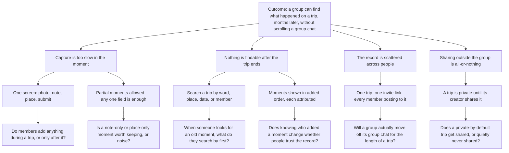

# EVALS.md

Status: ACTIVE. Accountable: Reviewer. Phase 1: Semaj. Phase 2: Rishika. Phase 3 (Final Reviewer and Evaluator): Giancarlo

## Opportunity Solution Tree

## Riskiest Assumption (RAT)

**Assumption:** people will add moments *during* a trip, not after it.

**Why it is the riskiest:** every opportunity below the outcome depends on a record existing. Search (F5) has nothing to search, attribution (F4) has nothing to attribute, and sharing (F6) has nothing to share. If capture happens only after the trip — or not at all — the app is a photo album people fill out as homework, and the outcome is unreachable no matter how good the rest of the build is. It comes from A1, the leftmost assumption test in the tree.

**What would show it is false:** in user research by October 22, people describe taking photos during trips but writing anything down only afterward, if ever. In Phase 2, moments whose timestamps cluster after a trip's end date rather than during it.

**How we would test it cheaply:** ask the three interviewees for their last trip, and have them open their camera roll and their group chat and show us what they posted and when. Past behavior, not intention — the HW2 rule.

## RAT Test

### RAT Results — run 2026-10-20 by Rishika Sikhakolli (Reviewer/Evaluator)

**Assumption tested:** people will add moments *during* a trip, not after it.
**Method:** three interviews about each person's most recent trip, with their camera roll and group chat open. Past behavior only.

| Question | Person 1 | Person 2 | Person 3 |
|---|---|---|---|
| Who (role only, no names) | full-time employee | intern | student |
| Trip (where, how long, group size) | New York, one month, 2 people | Taiwan, 2 days, 3 people | San Francisco, 5 days, 6 people |
| When were photos taken? | During | During | During |
| When were things posted to the group chat? | During | During | After |
| When were notes, captions, or reviews written? | During | After | After |
| What was posted most? | Photos + text | Photos | Photos |
| Did they look for something from the trip later? | Yes, found it | Yes, found it | No |
| How did they search? | Searched a word | Asked someone | Didn't |
| One observation or short quote | Sent a photo with text to the chat and later found it by searching for a word | Enjoyed when people sent things in the group chat to reminisce on an old event | Wanted stuff in shared album, likes accessibility of everything together |

**Summary:** 3 of 3 took photos during the trip. 2 of 3 posted to the group chat during the trip. Only 1 of 3 wrote notes or captions during the trip; the other 2 wrote them after.

**Result:** Mixed. Everyone captured photos in the moment, but most wrote text only afterward. This supports the RAT for photos but not for notes, which backs keeping the note optional (F3-1) and makes searching by place, date, or member more important than searching by a word from the note (F5-1).

## Evals Planned for Phase 2

| What | Grader | Checks |
|---|---|---|
| Code eval, `evals/` run with `npm test` | Code | One test per Must-be EARS row with a server-side effect: F1-2 duplicate username, F2-2 join without a valid invite, F3-3 empty moment refused, F4-2 deleting someone else's moment refused. Each test names its EARS row in the title. |
| Judgment eval, `docs/JUDGEMENT.md` | Rubric, two graders | At least ten binary questions covering the rows code cannot check: attribution visible on every moment, search terms preserved on an empty result, a private trip invisible to non-members. Two columns, disagreements marked. Agreement under 80 percent is a finding about the rubric. |
| Error-analysis log | Human | Every failure across the probe, the tests, and the judgment eval, counted and sorted. The most frequent failure is the next fix. |

## Prediction Stakes

Each member commits their own stake, in their own commit, before any Phase 2 code. Predictions are never edited; results are written beneath them.

### Semaj Johnson II, Reviewer — committed 2026-10-07

**Prediction:** Fewer than half of the moments created during Phase 2 testing will carry all three of photo, note, and place. F3-1 allows any one of the three, and I expect people to use that permission constantly rather than occasionally.

**How we will check:** Count every moment created across all test trips and sort by how many of the three fields it has. If half or more carry all three, this prediction is wrong.

**Confidence:** 75%

**Why:** F3 exists because capture has to be fast enough to beat the group chat. Anything that makes a moment take longer gets skipped in the moment it was meant to capture. If this is right, F4-1 and F5-1 both need to read well against mostly-partial records, and the trip view cannot assume a note is there.

**How we will check:** Watch three people open a multi-member test trip without instruction and note what they say first.

***Result (2026-10-21):** Correct. 3 of 7 moments in the test trip carried all three of photo, note, and place, below the half his prediction named. The sample is one trip with 4 accounts, so the margin is thin.*

### Rishika Sikhakolli, Specifier — committed 2026-10-08

**Prediction:** People might have things they want to add to the trip feeds that don't have all three criteria (photo, review, location name). F3-1 makes the note optional, members will mostly post a photo and a place, so searching by a word from the note (F5-1) will find fewer moments than searching by place, date, or member.

**How we will check:** During user testing, count what is added across all test trips. If the majority f them include a note, this prediction is wrong.

**Confidence:** 60%

**Why:** Profile 1 shares quickly and has little patience for writing, and the probe showed that requiring all three fields was a guess, so F3-1 now lets people skip the note. Profile 2 wants to say more than a caption, which is why I am not more confident. If this is right, F5 should treat place, date, and member as the main ways to search.

***Result (2026-10-21):** Wrong. 7 of 7 moments in the test trip included a note, the opposite of the prediction: people skipped the photo or place, not the note. Searching by a word from the note (F5-1) would have found every moment.*

### Aashi Mehta, Implementer — committed 2026-10-08

**Tight:** F4 will not be tested properly because we will only have a few dummy accounts created to test the features. In order to test the feature, we need to multiple accounts who are all part of various trips. 

***Result (2026-10-21):** F4 was tested with 4 real accounts in one shared trip, and all three F4 judgment questions (Q8–Q10) passed with both graders, including deleting someone else's moment, which was refused.*

**Loose:** F3 will be used a lot during Phase 2, because we will be conducting tests to see that our features work properly and know how to deal with errors. 

***Result (2026-10-21):** F3 was the most-used feature in testing: 7 moments were added to the test trip, but that is a small sample from one trip.*

**Open:** Likes and comments are allow when trips are shared publicly, but if the creator doesn’t want to share them publicly, can the trip participants still comment?

***Result (2026-10-21):** Not answerable in Phase 2. Likes and comments (F8) were not built, so whether trip members can comment on an unshared trip is still open. A tester did in fact voice a desire for comment/like ability.*

### Giancarlo (Architect), committed 2026-10-08

**Prediction:** Storing trip photos directly in D1 will not work at real phone-photo sizes. Before F3 (Add a moment) passes with photos taken on a phone, the team will need a separate file store (such as Cloudflare R2) or will have to shrink photos in the browser before upload.

**How we will check:** During Phase 2, three members each add one full-size phone photo to a test trip. If all three save and display through Workers and D1 alone, with no added service or resizing step, this prediction is wrong.

**Confidence:** 70%

**Why:** D1 is built for rows of text and numbers, not large files, and phone photos are often several megabytes. ADR-001 names only Workers and D1, so if this is right, ADR-001 will need a revision in Phase 2.

***Result (2026-10-21):** Correct. 3 of 3 phone photos saved and displayed on Workers and D1 with no added storage service, but only because the build shrinks every photo in the browser before upload (`shrinkPhoto` in `public/app.js`, capped at 700,000 characters by the Worker).*

## Where the Stakes Disagree
*Nothing was inputted during Phase 1 for where the stakes disagree. I (Rishika), Phase 2 Reviewer, went through and deliberated the prediction stakes at the beginning of Phase 2 to fill this out.*
Semaj and Rishika agree most moments will be partial, but disagree on which field is dropped. A test trip full of photo-and-note moments would prove Semaj right and Rishika wrong. Giancarlo predicts full-size phone photos will fail on Workers and D1 alone which would mean photos are rarer for technical reasons and not choice. Aashi’s Tight stake predicts too few test accounts to exercise F4. In this case, the moments counted for Semaj’s and Rishika’s stakes will come from teammates testing features.

## Final Status (Phase 3)

Closed out 2026-10-27 by Giancarlo Martinez-Saldana, Final Reviewer and Evaluator. Every check this file planned, and every stake above, is accounted for here. Stake headers that read `<date>` and `<2026-10-08>` now carry the date of the commit that added each stake (`d616dac` and `a0f07ce`, both 2026-10-08); no prediction or result text was changed.

| Check | Planned in | Ran? | Result | Recorded in |
|---|---|---|---|---|
| Code evals F1-2, F2-2, F3-3, F4-2 | Evals Planned, row 1 | Yes, 2026-10-21, against the deployed Worker | 4 of 4 pass; breaking F4-2 on purpose made its test fail | `evals/worker.test.js`, DDR-004 |
| Judgment eval, at least ten binary questions, two graders | Evals Planned, row 2 | Yes, 2026-10-20 and 2026-10-21 | 10 of 10 Yes from both graders, 100% agreement. The planned "search terms preserved" question was not run because F5 was not built, and no question covered F3-2. | `docs/JUDGEMENT.md` |
| Error-analysis log | Evals Planned, row 3 | Only partly in Phase 2: JUDGEMENT.md logged "no failures" for the tests and judgment eval but did not cover the probe. Completed below in Phase 3. | 25 failures in 5 categories | Error-Analysis Log below |
| RAT test, three interviews | RAT section | Yes, 2026-10-20 | Mixed: photos captured during the trip 3 of 3, notes written during the trip 1 of 3 | RAT Results above, `docs/VALIDATION.md` |
| Prediction Stakes | Prediction Stakes | All four resolved 2026-10-21 | 2 correct (Semaj, Giancarlo), 1 wrong (Rishika), 1 mixed (Aashi: Tight wrong, Loose correct, Open untestable) | Each stake above |

## Error-Analysis Log

The plan asked for every failure across the probe, the tests, and the judgment eval, counted and sorted. The tests and judgment eval found none on the deployed build, so this log also counts the failures found before deployment, by the builder runs and in review, because that is where the project's failures actually were.

| Rank | Failure category | Count | Instances (where recorded) |
|---|---|---:|---|
| 1 | The spec was silent and a builder had to guess | 11 | 5 spec gaps from the bolt.new probe (`docs/PROBE-001.md`); 3 F2 gaps from HW6 (PR #68, issue #59); 3 F3 gaps from HW6 (PR #89, issues #76 and #92) |
| 2 | A document and the code or another document disagreed | 6 | ARCHITECTURE.md schema differed from `db/schema.sql` (no `sessions` table, no case-insensitive usernames, PR #61, fixed in #71); TOOLS.md lost its Cloudflare rows (PR #22, restored in #65); EVALS.md and DDR-004 named `JUDGMENT.md` while the file was `JUDGEMENT.md` (PR #84); README linked a file that did not exist and had broken italics (PR #86); the Phase 2 F2 changes in PR #68 merged into a side branch, not `main`, so FEATURES.md never received them; this file's Judgment eval row named the wrong file until Phase 3 |
| 3 | AI-drafted work was committed without a DDR | 3 | Three PRs said "AI use: None" for work Claude helped draft (`35ce13d`, `489036d`, `6e2908f`), found and covered by DDR-004 |
| 4 | A test or check could not detect what it claimed to | 3 | The first code-eval draft guessed the routes and sign-in wrong (DDR-004); `?failSave` only simulates F3-2 in the browser, and a DevTools Offline test did not block the request (DDR-003); no judgment question covered F3-2 |
| 5 | A UI defect reached a draft | 2 | CSS overrode the `hidden` attribute, showing a broken photo preview (DDR-003); input borders measured 1.42:1, below the 3:1 STYLE.md requires (PR #81) |

**The most frequent failure is the next fix.** Silent specs caused 11 of 25 failures, and every one was found by giving the spec to a builder, not by the team reading it. The next fix is to run a builder probe on every Must-be feature before building it, which Phase 2 did only for F2 and F3. The second-most frequent, documents drifting from code, was caught every time by a human review rather than a check; a code eval that compares `db/schema.sql` to the schema in ARCHITECTURE.md would have caught the largest one automatically.
